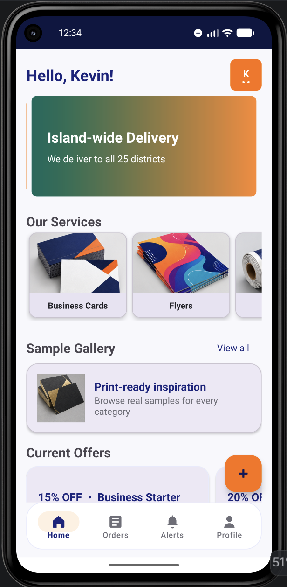

# PrintXpress — Android Mobile Application

**PrintXpress** was completed for the **Mobile Application Development** module in the **3rd semester** of the **Higher Diploma in Computing & Software Engineering**. Built with Java, XML layouts and Room (SQLite), it demonstrates browsing custom printing products and recording print orders in an **on-device academic workflow**. The original source code and local database implementation are preserved.

> **Project status:** Academic demonstration, not a live online print store or real payment-processing product. The original order form contains card-style input fields used for local validation. **Never enter actual payment-card details.** No payment gateway is implemented in the checked-in code.

## Features implemented in the repository

| Feature | Implementation |
| --- | --- |
| Account registration and login | Local user accounts using Room storage and app sessions |
| Product catalogue | Business cards, flyers, banners, posters, stickers, T-shirts, and mugs |
| Product browsing | Category-based product lists and illustration assets |
| New order flow | Product, quantity, material, size, delivery/pickup, requested date, and custom instructions |
| Print artwork | Select a local file or saved design for an order |
| Order management | Saved orders, order details, and locally tracked status |
| Design library | Saved artwork references for reuse |
| Customer area | Profile and notification screens |
| Supporting screens | Gallery, FAQs, and design guidelines |
| Promotions | Locally seeded promotional content and home-page banners |

The list above is based on the checked-in screens and local data model, not a claim that all features have been tested on devices.

## Technical stack

| Area | Technology |
| --- | --- |
| Platform | Android (native) |
| Language | Java 17 |
| Interface | XML layouts, Material Components, RecyclerView, ViewPager2 |
| Local storage | Room ORM with an SQLite database |
| Project tooling | Gradle, Android Studio |
| Unit tests | JUnit 4 (`ValidationUtilsTest.java`) |

**Android configuration:** `compileSdk 34`, `targetSdk 34`, `minSdk 21`.

The application stores users, products, orders, notifications, addresses, saved designs, and promotions in a local Room database called `printxpress.db`. `AppDatabase.java` specifies database version 3 and includes migration code from versions 1 → 2 → 3.

## Project structure

```text
printxpress/
├── app/
│   ├── build.gradle
│   └── src/
│       ├── main/
│       │   ├── AndroidManifest.xml
│       │   ├── java/com/printxpress/app/
│       │   │   ├── *Activity.java       # Application screens
│       │   │   ├── adapters/            # RecyclerView / banner adapters
│       │   │   ├── database/            # Room, DAOs, entities, local seeders
│       │   │   └── utils/               # Sessions and input validation
│       │   └── res/                     # XML layouts and drawable assets
│       └── test/                        # Validation utility JUnit tests
├── build.gradle
├── settings.gradle
└── gradle.properties
```

## Open the project in Android Studio

1. Install **Android Studio**, **JDK 17**, and the Android SDK for API level 34.
2. Clone the repository:

   ```bash
   git clone https://github.com/kevin-menuja/printxpress.git
   ```

3. In Android Studio, select **Open** and choose the cloned project directory.
4. Configure the required Android SDK and let Gradle synchronize.
5. Select an emulator or a physical Android device meeting the application's minimum SDK requirement and run the `app` configuration.

**Build-tooling note:** The repository includes `gradlew` scripts but currently does **not** contain the `gradle/wrapper/` files. Gradle synchronization or command-line builds may require configuring a compatible Gradle installation or restoring wrapper files in a separate tooling update. A successful build has not been independently verified as part of this documentation update.

### Unit tests

The source contains JUnit tests for Sri Lankan mobile-number validation, card-number checksum checks, expiry-date validation, and order-total calculations:

```text
app/src/test/java/com/printxpress/app/utils/ValidationUtilsTest.java
```

With a working Gradle and Android SDK environment, the corresponding task is `testDebugUnitTest`. **Presence of tests does not mean they have been executed successfully** in this review.

## Data and payment boundaries

- **Local-first demonstration:** Orders and account records are saved in the app's own Room/SQLite database; there is no demonstrated server-side order-sync API.
- **Academic card form:** Card inputs are checked locally for formatting and validity; the app is **not** integrated with a real payment processor. Do not submit real card details or treat an on-device order confirmation as a settled payment.
- **Seeded content:** Products and promotional messages are created by local seed logic. They should not be interpreted as live pricing or offers.
- **Release scope:** No publicly deployed production backend, payment certification, or Play Store release is claimed.

## Code references

- [Android manifest](app/src/main/AndroidManifest.xml)
- [Gradle configuration](app/build.gradle)
- [Room database and migrations](app/src/main/java/com/printxpress/app/database/AppDatabase.java)
- [Order workflow](app/src/main/java/com/printxpress/app/NewOrderActivity.java)
- [Home screen](app/src/main/java/com/printxpress/app/HomeActivity.java)
- [Validation tests](app/src/test/java/com/printxpress/app/utils/ValidationUtilsTest.java)

## Academic attribution

**Type:** Original academic Android application  
**Developer listed in the original README:** Kevin Menuja Karunarathne  
**Current GitHub owner:** [Kevin Menuja](https://github.com/kevin-menuja)

The original application code and database have not been changed by this README update. Existing source history and contributions are preserved.

---

## Original application screenshots and testing evidence

Authentic screenshots extracted without edits from my **CSE5011 — Mobile Application Development** submitted report. These are historic coursework captures, not freshly run application tests.



- [Browse the application screenshot gallery](docs/screenshots/README.md)
- [Read the historical test evidence and case-by-case traceability](docs/evidence/REPORT_TEST_EVIDENCE.md)
- [Inspect screenshot provenance and SHA-256 checksums](docs/evidence/SOURCE_PROVENANCE.json)

> The original academic application and database were preserved. Demonstration payment forms are not real payment processing.
