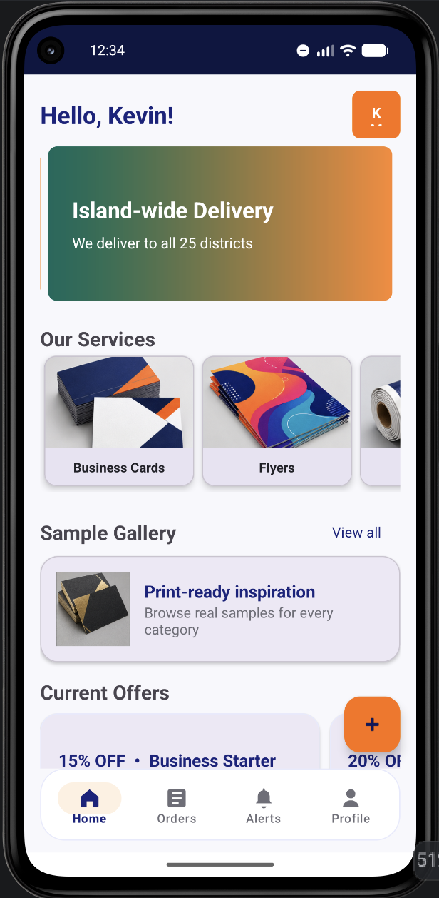
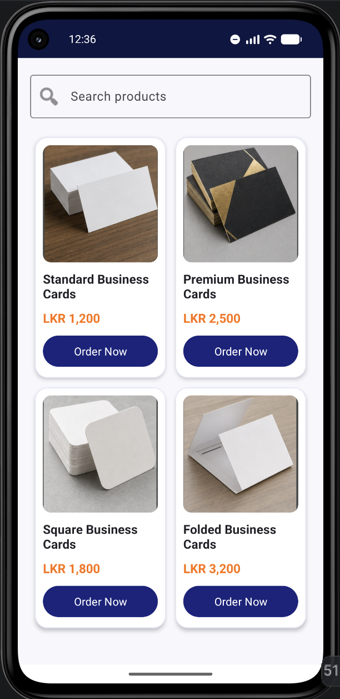
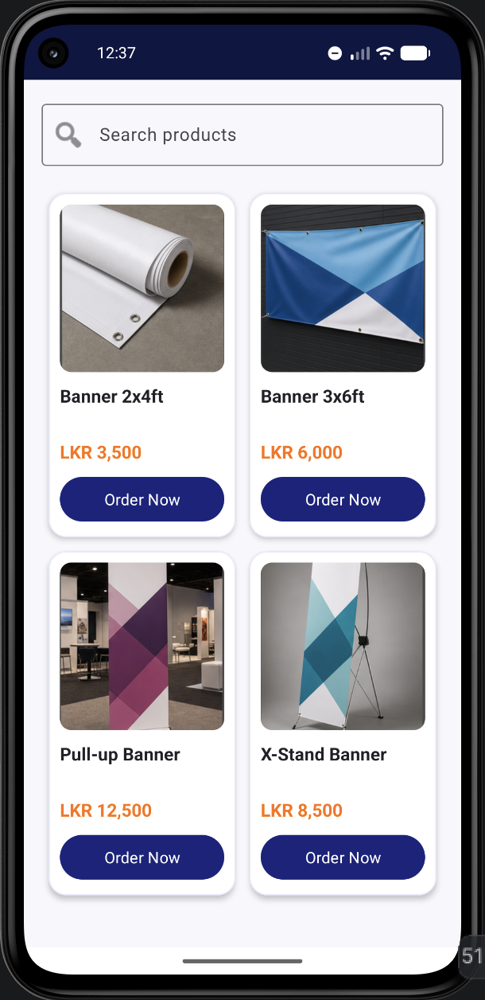
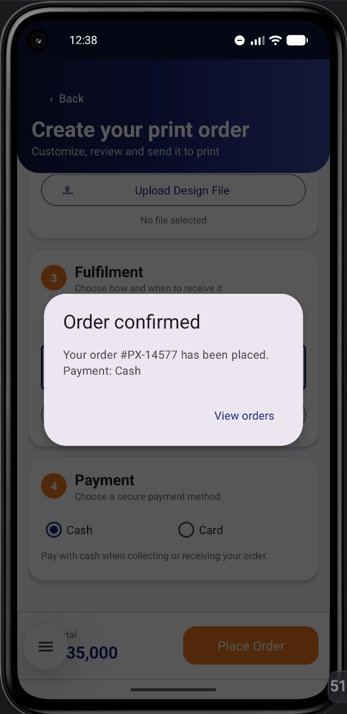
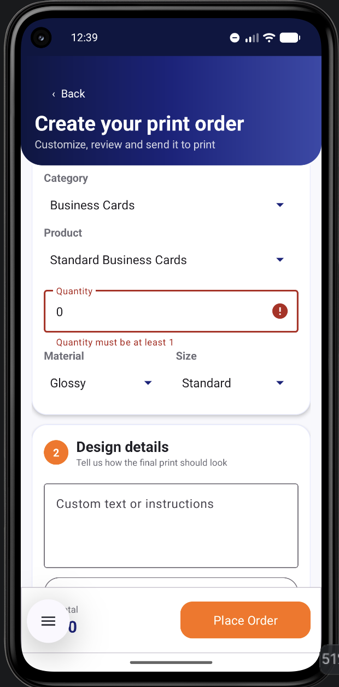
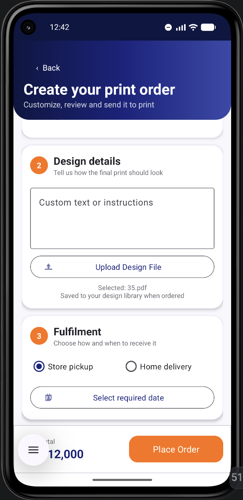
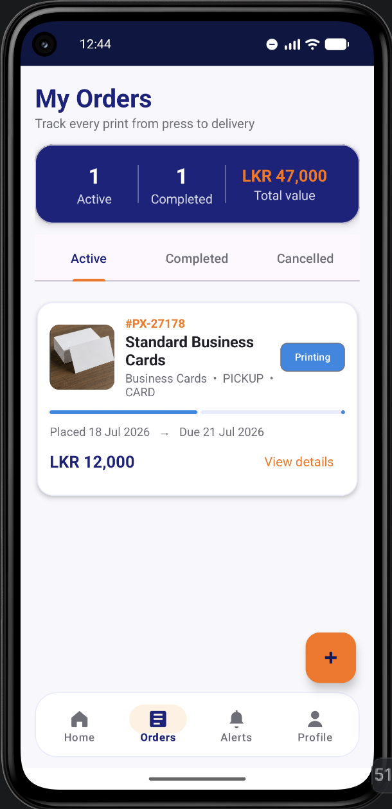
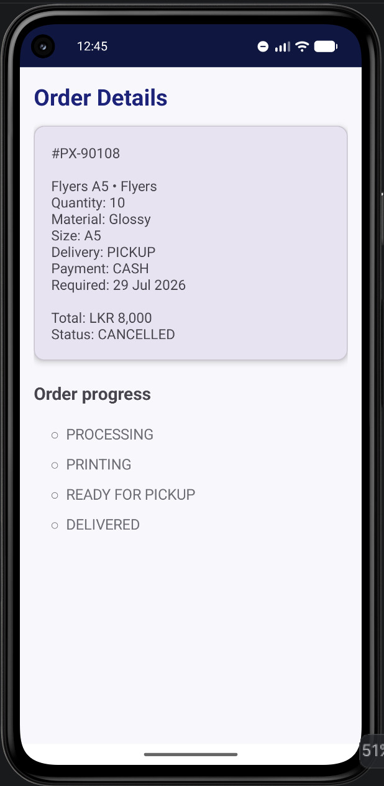
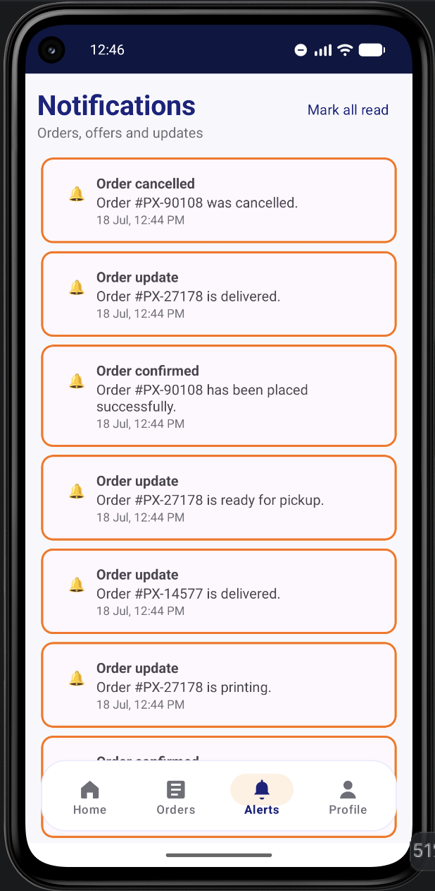

# PrintXpress Mobile App — Authentic Application Screenshots

These screenshots are **unaltered image assets extracted from the submitted CSE5011 — Mobile Application Development report** (`st20345403_CSE5011_WRIT1.docx`). They document the coursework application at the time of submission; they are **not new runtime screenshots**.

> **Authenticity:** Original embedded PNG bytes are preserved. Every screenshot has its source media filename and SHA-256 checksum in [`SOURCE_PROVENANCE.json`](../evidence/SOURCE_PROVENANCE.json).

## Application gallery

### 1. PrintXpress home and product categories

*Report source:* `word/media/image65.png` · Task E — test case TC07, Figure 48.

### 2. Product catalogue

*Report source:* `word/media/image66.png` · Task E — test case TC08, Figure 49.

### 3. Search result for banners

*Report source:* `word/media/image67.png` · Task E — test case TC09, Figure 50.

### 4. Locally simulated order confirmation

*Report source:* `word/media/image68.png` · Task E — test case TC10, Figure 51.

### 5. Quantity input validation

*Report source:* `word/media/image69.png` · Task E — test case TC11, Figure 52.

### 6. Print artwork upload in order flow

*Report source:* `word/media/image70.png` · Task E — test case TC12, Figure 53.

### 7. Order history list

*Report source:* `word/media/image72.png` · Task E — test case TC14, Figure 55.

### 8. Order details and progress

*Report source:* `word/media/image73.png` · Task E — test case TC15, Figure 56.

### 9. Order notifications

*Report source:* `word/media/image75.png` · Task E — test case TC17, Figure 58.

## Historical testing evidence

The submitted report documents **20 test cases**. Historical outcomes are summarized in [the report test-evidence summary](../evidence/REPORT_TEST_EVIDENCE.md), with traceability in [`REPORT_TEST_EVIDENCE.md`](../evidence/REPORT_TEST_EVIDENCE.md).

**Important:** Reported test outcomes describe what was documented in the coursework; they do not certify that the current repository was rebuilt, re-run, or independently retested. For any simulated payment flows, no real card transaction or settlement is evidenced.

*The original academic application, database implementation, and workflows have not been altered.*

## Design documentation

[See original planning diagrams from the report](../evidence/DESIGN_EVIDENCE.md). These diagrams are design artifacts, not live app screenshots.
